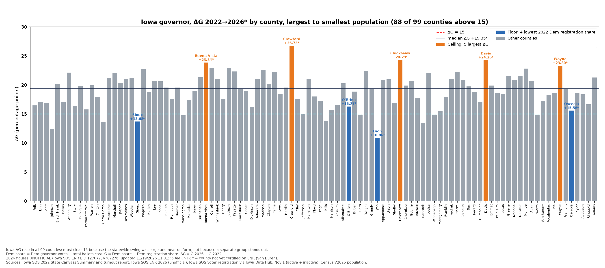
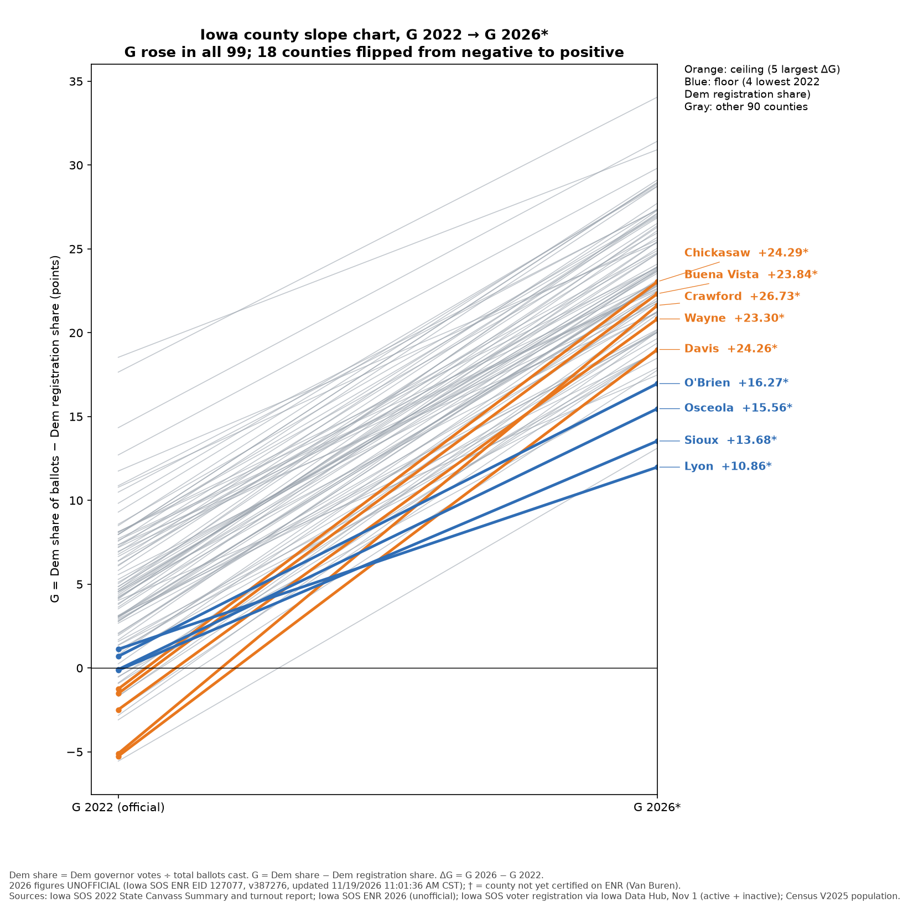

# Floor and Ceiling Counties

> **\*2026 figures are unofficial and not certified by the Iowa Secretary of State.** The State Canvass has not been completed. On the SOS results site (election 127077, last updated 11/19/2026 11:01:36 AM CST),  of  counties show certified county results;  does not. Governor race unless a page says otherwise. Votes are votes for the Democratic candidate, not a count of registered Democrats who voted. Registration is the Iowa SOS Nov 1 report for each year (active + inactive). These pages measure a pattern; they make no claim about intent, fraud or cause.

## How to read floor and ceiling counties

Look for the pattern at both ends. The ceiling counties are the ones with the highest ΔG; in Iowa those are . The floor counties are the most Republican baseline counties, where there were the fewest Democrats to move.

- **The floor** by ΔG is the single county with the lowest ΔG in the state. In Iowa that's , at \*. Unlike Nebraska, no Iowa county has a negative ΔG, so the floor is the smallest rise, not a decline.
- **The ceiling** is the single county with the highest ΔG in the state. In Iowa that's , at \*.

Every state has its own floor and ceiling. Those two extremes set the range the rest of that state's counties fall within.

## Terminology

- **Ceiling counties** are residual counties with the largest positive ΔG: they lost registered Democrats and moved most. : Crawford \*, Chickasaw \*, Davis \*, Buena Vista \*, Wayne \*.
- **Floor counties** are the most Republican baseline: the four lowest 2022 Democratic registration shares. Sioux  (ΔG \*), Lyon  (ΔG \*), Osceola  (ΔG \*), O'Brien  (ΔG \*). Read by ΔG instead, the five lowest are . Lyon and Sioux are on both lists.
- **Non-loss counties** had no Democratic registration loss. Raw numbers only, no residual step:
  - Dallas: registered Democrats  → ; Democratic governor votes  → \*.
- **Registration fell and votes fell too:** none in Iowa. Democratic governor votes rose in all  counties.
- **Ballots fell, Democratic votes rose** ( counties): . These are flagged for how their votes moved, not because their ΔG is unusual.

## Most Iowa counties clear the ceiling test

 of  counties have ΔG above 15, and  had a vote-share jump of 14 points or more while their registration share fell. That reflects the size of Iowa's statewide swing (median ΔG \*), not a separate group of ceiling counties: the top five sit at the top of one continuous spread. Only  counties are at or below 15: .

An earlier run (Nov 18) used the governor-race total as the denominator. On that basis  counties are above 15 and the top five are . This page uses the locked ballots denominator.

## Ceiling and floor detail

Largest to smallest population.

| County | Group | Population | G 2022 | G 2026* | ΔG* | Dem reg share 2022 → 2026 | Dem reg 2022 → 2026 | Dem gov votes 2022 → 2026* | Implied extra votes* |
|---|---|---|---|---|---|---|---|---|---|
| Sioux | Floor |  |  |  |  |  →  |  →  () |  →  |  |
| Buena Vista | Ceiling |  |  |  |  |  →  |  →  () |  →  |  |
| Crawford | Ceiling |  |  |  |  |  →  |  →  () |  →  |  |
| O'Brien | Floor |  |  |  |  |  →  |  →  () |  →  |  |
| Lyon | Floor |  |  |  |  |  →  |  →  () |  →  |  |
| Chickasaw | Ceiling |  |  |  |  |  →  |  →  () |  →  |  |
| Davis | Ceiling |  |  |  |  |  →  |  →  () |  →  |  |
| Wayne | Ceiling |  |  |  |  |  →  |  →  () |  →  |  |
| Osceola | Floor |  |  |  |  |  →  |  →  () |  →  |  |

**Ceiling profile.**
- **Starting G:**  of 5 ceiling counties began 2022 with a negative G (Democratic vote share behind registration share) and turned positive in 2026. Statewide,  counties flipped from negative to positive; the number of counties with a negative G in 2026 is .
- **Registration decline:** Democratic registration fell in  of 5, by  to .
- **Voting method:** all Iowa counties vote at precinct polling places plus absentee ballots. Iowa law does not allow vote centers in general elections ([Iowa Code § 49.11](https://www.legis.iowa.gov/docs/code/49.11.pdf)), so Iowa has no vote-center vs precinct or all-mail vs precinct contrast like Nebraska's.

**Floor profile.** The four floor counties are in the northwest corner of the state and have the lowest Democratic registration shares. All four rose, and  of 4 rose less than the statewide median ΔG.

Statewide, ΔG rose in  of  counties (median about ).

*All 99 counties, ΔG in population order. Orange: ceiling (5 largest ΔG). Blue: floor (4 lowest 2022 Democratic registration share). Dashed red line at ΔG = 15.*

*Each line is one county, G 2022 to G 2026*. Ceiling counties in orange, floor counties in blue, labeled with ΔG.*

---
**Related:** [Bottom-Up Reverse Math](Reverse-Math) · [Graphs](Graphs) · [Locked Iowa Formula](Locked-Iowa-Formula) · [Home](Home)
