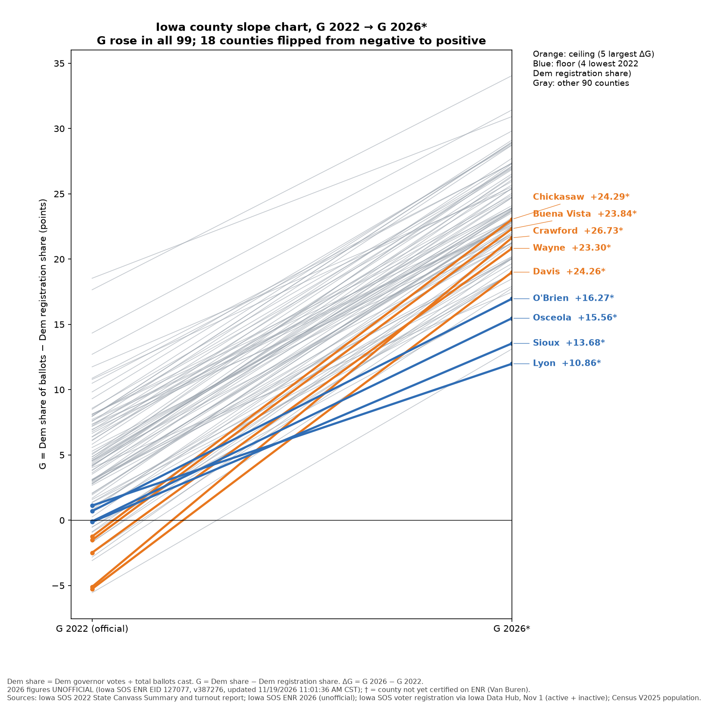
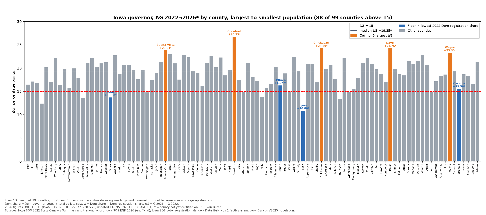
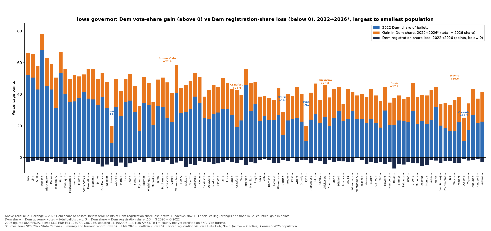
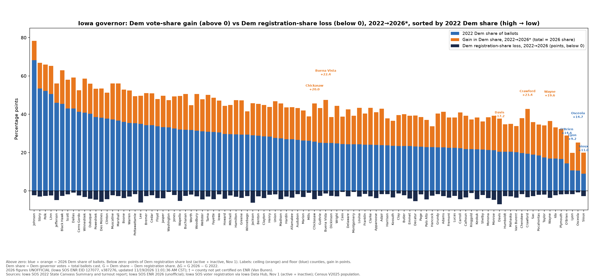
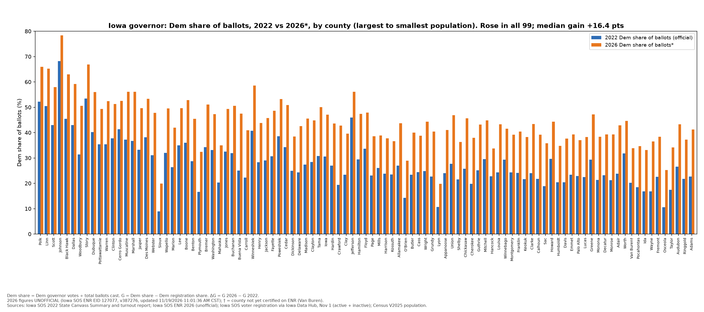
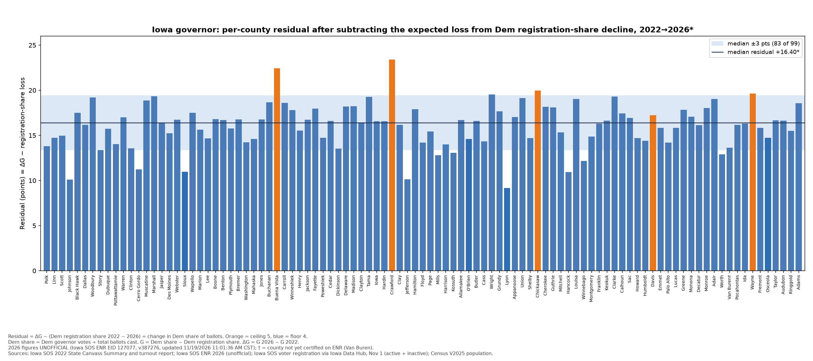
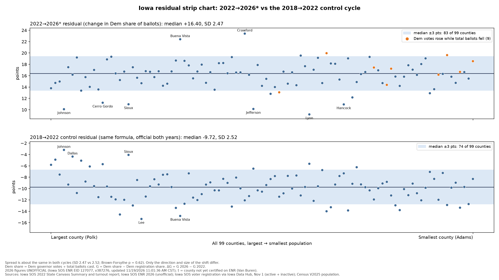
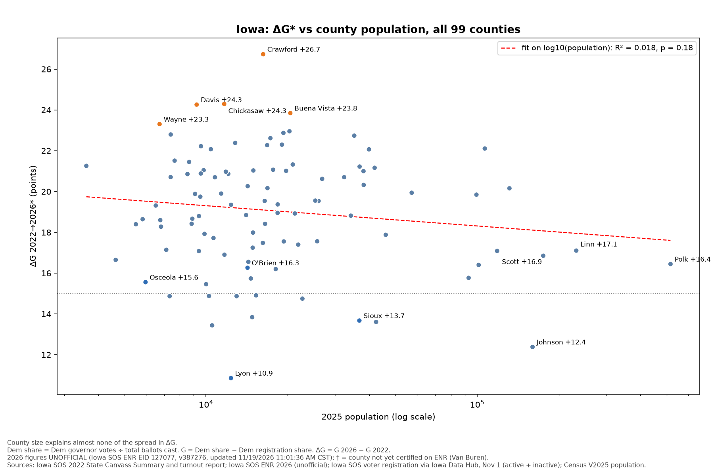

# Graphs

> **\*2026 figures are unofficial and not certified by the Iowa Secretary of State.** The State Canvass has not been completed. On the SOS results site (election 127077, last updated 11/19/2026 11:01:36 AM CST),  of  counties show certified county results;  does not. Governor race unless a page says otherwise. Votes are votes for the Democratic candidate, not a count of registered Democrats who voted. Registration is the Iowa SOS Nov 1 report for each year (active + inactive). These pages measure a pattern; they make no claim about intent, fraud or cause.

All charts use the ballots denominator and list counties largest to smallest population unless the title says otherwise.

## 1. County slope chart

*Each line is one county, G 2022 to G 2026*. G rose in all 99 counties. Orange: the five ceiling counties; blue: the four floor counties; each labeled with its ΔG*.*

## 2. ΔG by population

*All 99 counties in population order. Ceiling: Crawford is the highest ΔG*. Floor by ΔG: Lyon is the lowest*. Dashed red line at 15.*

## 3. Stacked share bars with registration loss

*Democratic vote-share gain (above the line: 2022 share plus 2022 to 2026 gain*) and registration-share loss (below the line), all 99 counties in population order.*

*The same bars sorted by 2022 Democratic share of ballots, highest to lowest.*

## 4. Paired bars, 2022 vs 2026

*Democratic share of ballots, 2022 (blue) and 2026* (orange), all 99 counties in population order.*

## 5. Residual charts

*Residual (ΔG minus registration-share loss) for all 99 counties. Shaded band: median ±3 points.*

*Top: 2022 to 2026* residual. Bottom: the same formula on 2018 to 2022 (official both years). The spread is about the same in both cycles; only the direction and size of the shift differ. Orange: counties where Democratic votes rose while total ballots fell.*

## 6. ΔG scatter (population)

*ΔG* against population (log scale) for all 99 counties. County size explains almost none of the spread.*

---
**Related:** [Floor and Ceiling Counties](Floor-and-Ceiling) · [Bottom-Up Reverse Math](Reverse-Math) · [Locked Iowa Formula](Locked-Iowa-Formula) · [Home](Home)
