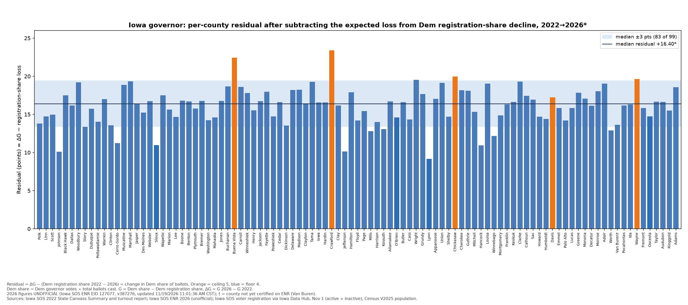

# Bottom-Up Reverse Math

> **\*2026 figures are unofficial and not certified by the Iowa Secretary of State.** The State Canvass has not been completed. On the SOS results site (election 127077, last updated 11/19/2026 11:01:36 AM CST),  of  counties show certified county results;  does not. Governor race unless a page says otherwise. Votes are votes for the Democratic candidate, not a count of registered Democrats who voted. Registration is the Iowa SOS Nov 1 report for each year (active + inactive). These pages measure a pattern; they make no claim about intent, fraud or cause.

The same arithmetic at three levels, from one county up to the whole state, then solved backward for implied extra votes. Ballots denominator (Democratic governor votes ÷ total ballots cast). The method comes from the [Cedar County Audit](https://github.com/mbenson8989/Nebraska-Election-Analysis-/wiki/Cedar-Audit) in Nebraska.

## Step 1: Dubuque County

| Step | Value |
|---|---|
| Democratic vote share |  (2022) → * (2026): ** points*** |
| Democratic registration share |  → : ** points** |
| ΔG = vote-share growth − registration-share change |  − () = ** points*** |
| Reverse step: ΔG − registration-share loss |  −  =  (the residual) |
| Implied extra votes | * −  × * = **about *** |
| Registration-scaled gap (the Nebraska wiki's "gap in votes" line, for comparison) | * −  × ( ÷ ) = about * |

## Step 2: the six largest counties

Largest to smallest population.

| County | Population | Dem reg 2022 → 2026 | Dem gov votes 2022 → 2026* | Ballots 2022 → 2026* | Vote-share growth* (pts) | Registration-share change (pts) | ΔG* (pts) | Implied extra votes* |
|---|---|---|---|---|---|---|---|---|
| Polk |  |  →  |  →  |  →  |  |  |  |  |
| Linn |  |  →  |  →  |  →  |  |  |  |  |
| Scott |  |  →  |  →  |  →  |  |  |  |  |
| Johnson |  |  →  |  →  |  →  |  |  |  |  |
| Black Hawk |  |  →  |  →  |  →  |  |  |  |  |
| Dallas† |  |  →  |  →  |  →  |  |  |  |  |

ΔG is positive in all six ( to \*).  of the six largest counties are below the statewide median ΔG (\*); Johnson is the lowest of the six.

† Dallas gained registered Democrats ( → ), so under the Nebraska rule it is a non-loss county and gets raw numbers only. Its residual is shown for completeness and is included in the statewide sums, because its registration *share* still fell ( points).

## Step 3: all  counties

| Group | Counties | Dem vote share | Dem registration share | Vote-share growth* | Reg-share change | Pooled ΔG* | County median ΔG* (range) | Implied extra votes* |
|---|---|---|---|---|---|---|---|---|
| Six largest counties |  |  → \* |  →  |  |  |  |  ( to ) |  |
| Other counties |  |  → \* |  →  |  |  |  |  ( to ) |  |
| All Iowa counties |  |  → \* |  →  |  |  |  |  ( to ) |  |

ΔG is positive in all  counties. The six largest counties moved a little less than the rest of the state (pooled ΔG \* vs \*). County size explains almost none of the spread (R² =  against log population).

## Solving backward: implied extra votes (hypothesis)

For each county, implied extra votes = 2026 Democratic votes − (2022 Democratic share of ballots × 2026 ballots). That is how many more Democratic votes the county cast than it would have at its 2022 share on 2026 turnout.

| Measure | Votes |
|---|---|
| Sum of the  county figures | * |
| Statewide, pooled: ( − ) ×  ballots | * |
| Raw rise in Democratic votes | * =  share gain +  from more ballots at the 2022 share |
| Offset need for the -point registration-share decline: switched / added votes |  /  |
| Same, with a 1-point cushion |  /  |
| Same, with a 2-point cushion |  /  |

Offset need: switched votes = s × N; added votes = s × N ÷ (1 − p + s), where s is the registration-share decline (plus any cushion), N is 2026 ballots and p is the 2026 Democratic share of ballots. The pooled statewide figure, \*, is  to  times the offset need.

> **Hypothesis label.** Turning the residual into "implied extra votes" and calling them injected, switched or offset votes is a hypothesis the arithmetic cannot test. The same number reflects candidate choice, crossover voting, turnout changes and any other cause. Candidate votes are not turnout, and registered Democrats are not the only people who vote for Democrats.

## What the arithmetic cannot tell you

- **The control cycle looks the same.** Run on 2018→2022, the same residual has SD  (vs \* now; Brown-Forsythe p = ). A tight, near-uniform residual is what a statewide swing produces; in 2018→2022 it ran the other way, with G falling in all  counties.
- **The swing was near-uniform.**  of  county residuals are within 3 points of the median (\*).
- **2026 is unofficial.** These totals come from the SOS results site and will be re-run after the State Canvass.

*Residual (ΔG minus registration-share loss) for all  counties, largest to smallest population.*

---
**Related:** [Locked Iowa Formula](Locked-Iowa-Formula) · [Floor and Ceiling Counties](Floor-and-Ceiling) · [Graphs](Graphs) · [Home](Home)
